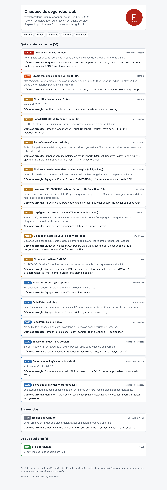

# chequeo-seguridad-web (website security check)

Checks the basic security of a website and builds a **report in Spanish for small-business owners**: what is wrong, why it matters and how to fix it. Prints to PDF from the browser.

> [Versión en español](README.md)



## What it checks

| Area | Checks |
|---|---|
| HTTPS | certificate validity and expiry, old protocols (TLS 1.0/1.1), http→https redirect, mixed content |
| Headers | HSTS, CSP, clickjacking (X-Frame-Options / frame-ancestors), nosniff, Referrer-Policy, Permissions-Policy, server/PHP version disclosure |
| Cookies | Secure, HttpOnly (session cookies), SameSite |
| Domain email | SPF (missing, duplicated, `+all`) and DMARC (missing, `p=none`) |
| WordPress | visible version, user enumeration via `/wp-json`, `xmlrpc.php` |
| Exposed files | `.env`, `.git`, `wp-config.php` copies, `.sql`/`.zip` backups, `phpinfo`, `server-status`, directory listing, `.DS_Store` |
| Good practice | `security.txt` |

Exposed files are confirmed by content signatures, so sites that answer 200 to every path produce no false positives.

## Two modes

- **Passive (default):** home page, `security.txt` and public DNS records only — what any visitor sees.
- **Full (`--completo --tengo-permiso`):** also probes private paths. **Only on your own sites or with the owner's written permission.** The tool refuses to run it without the flag.

## Usage

Node 18+, no dependencies.

```bash
node src/cli.js example.com --html report.html --autor "Name" --contacto "email"
node src/cli.js example.com --completo --tengo-permiso --json result.json
```

Exits with code 1 on critical/high findings, so it can run in CI after each deploy.

## Tests

`npm test` runs 9 tests, including a real local HTTPS server to read the certificate. The self-signed test key in `test/certs/` is allowlisted in `.gitleaks.toml`.

## Limits

Not a penetration test: no login attempts, no injection testing, no vulnerability database lookup for plugin versions.

## License

MIT. Author: Joaquin Alejandro Bobbio.
