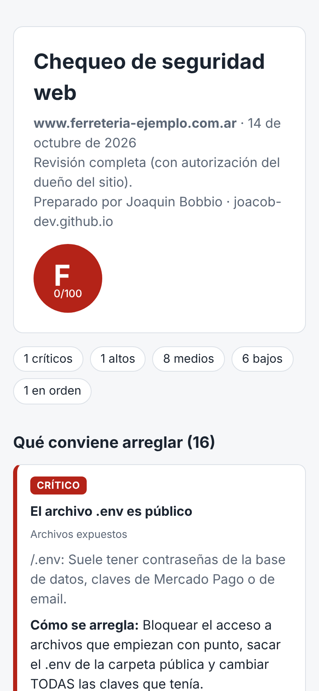

# chequeo-seguridad-web

Revisa la seguridad básica de un sitio web y arma un **informe en español, pensado para el dueño de una pyme**: qué está mal, por qué importa y cómo se arregla. Se imprime como PDF desde el navegador.

> [English version](README.en.md)



Ejemplo completo: [`docs/informe-ejemplo.html`](docs/informe-ejemplo.html) (sitio ficticio).

## Qué revisa

| Área | Chequeos |
|---|---|
| HTTPS | certificado válido y fecha de vencimiento, protocolo viejo (TLS 1.0/1.1), redirección de http a https, contenido mixto |
| Encabezados | HSTS, Content-Security-Policy, clickjacking (X-Frame-Options / frame-ancestors), nosniff, Referrer-Policy, Permissions-Policy, versión del servidor y de PHP visibles |
| Cookies | Secure, HttpOnly (en cookies de sesión) y SameSite |
| Email del dominio | SPF (falta, duplicado o `+all`) y DMARC (falta o `p=none`): evita que manden emails falsos con el dominio |
| WordPress | versión visible, usuarios listables por `/wp-json`, `xmlrpc.php` activo |
| Archivos expuestos | `.env`, `.git`, copias de `wp-config.php`, backups `.sql`/`.zip`, `phpinfo`, `server-status`, listado de carpetas, `.DS_Store` |
| Buenas prácticas | `security.txt` |

Cada archivo expuesto se confirma por su contenido (por ejemplo, que `.git/HEAD` empiece con `ref: refs/`), así que los sitios que responden "200" a cualquier ruta no dan falsos positivos.

Puntaje: arranca en 100 y resta 40 por crítico, 20 por alto, 8 por medio y 3 por bajo. Nota A (90+), B (75+), C (60+), D (40+), F.

## Dos modos, y cuándo usar cada uno

- **Pasivo (por defecto):** pide solo la página principal, `security.txt` y los registros DNS públicos. Es lo mismo que ve cualquier visitante.
- **Completo (`--completo --tengo-permiso`):** además prueba rutas privadas (`.env`, `.git`, backups). **Solo en sitios propios o con permiso escrito del dueño.** Probar rutas privadas de un sitio ajeno sin permiso puede ser delito (Ley 26.388, acceso indebido a sistemas). Sin `--tengo-permiso` el programa no lo hace.

## Uso

Necesita Node 18 o más nuevo. No tiene dependencias.

```bash
node src/cli.js mitienda.com.ar
node src/cli.js mitienda.com.ar --html informe.html --autor "Joaquin Bobbio" --contacto "WhatsApp +54 9 11 ..."
node src/cli.js mitienda.com.ar --completo --tengo-permiso --html informe.html --json resultado.json
```

Sale con código 1 si hay problemas críticos o altos, así que también sirve en un pipeline de CI para revisar un sitio después de cada deploy.

## Tests

```bash
npm test   # 9 tests: sitio mal configurado, sitio bien configurado, sitios que responden 200 a todo,
           # modo pasivo sin rutas privadas, sitio caído, plataformas, puntaje, HTML escapado,
           # y un servidor HTTPS local real para leer el certificado
```

El certificado de `test/certs/` es autofirmado y solo sirve para el test local; `.gitleaks.toml` lo excluye del escaneo de secretos.

## Estructura

```
src/chequeos.js      todos los chequeos y el puntaje
src/red.js           pedidos HTTP/HTTPS sin seguir redirecciones, leyendo el certificado
src/informe-html.js  informe para el cliente
src/cli.js           línea de comandos
docs/                informe de ejemplo y capturas
```

## Cómo venderlo (estimaciones, no datos verificados)

1. **Chequeo gratis como gancho:** a un negocio que ya es tu cliente o que te lo pide, le pasás el informe pasivo. Muchos sitios de pymes no tienen HSTS, CSP ni DMARC.
2. **Revisión completa con permiso:** precio orientativo ARS 25.000 a 40.000 por sitio, con informe y una reunión corta para explicarlo.
3. **Arreglo:** cobrar aparte la corrección (encabezados, SPF/DMARC, actualizar WordPress), orientativo ARS 40.000 a 80.000 según el hosting.
4. **Mantenimiento mensual:** revisión mensual automática y aviso si algo cambia, orientativo ARS 10.000 a 15.000 por mes.

No mandes informes "en frío" de sitios ajenos con el modo completo. Con el modo pasivo sí podés mostrar lo que ve cualquiera, pero ofrecé la revisión completa recién con permiso por escrito.

## Límites

- No es una prueba de penetración: no intenta entrar, no prueba contraseñas ni inyecciones.
- No compara versiones de WordPress o plugins con una base de vulnerabilidades (sería el siguiente paso, por ejemplo con WPScan).

## Licencia

MIT. Autor: Joaquin Alejandro Bobbio.
